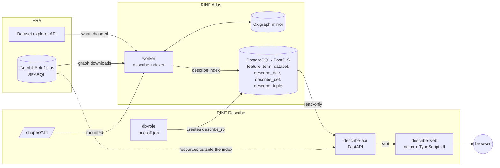

# Architecture

RINF Describe has no indexer and no database of its own. It runs next to
[RINF Atlas](https://github.com/Matdata-eu/rinf-atlas): Atlas's worker evaluates this
repository's SHACL shapes into Atlas's database, and RINF Describe reads them from there
through a read-only role. RINF Describe adds two containers and a one-off job.

| Part | Technology | Role |
|---|---|---|
| `shapes/` | SHACL, DASH, `rd:` terms | What each class page shows: groups, tabs, order, and the widget of each row ([shapes.md](shapes.md)). Read by Atlas's worker for the index, and by the API for pages built live. |
| Atlas `worker` | Python, pyoxigraph | With `ATLAS_DESCRIBE=1`, compiles the shapes and stores one evaluated document per resource and shape (`describe_doc`), the compiled layouts (`describe_def`) and a copy of every triple (`describe_triple`). Labels go to Atlas's `term` table. See Atlas's [docs/describe.md](https://github.com/Matdata-eu/rinf-atlas/blob/main/docs/describe.md). |
| `db-role` | `postgres` image, `db/readonly.sql` | Creates or updates the `describe_ro` role with `SELECT` on the tables the API reads, then exits. Runs on every `docker compose up`. |
| `describe-api` | Python, FastAPI, psycopg | Pages, triples, graph, exports, search, examples and sitemaps, all read from Atlas's database as `describe_ro`. A resource the index does not hold is read live from ERA's SPARQL endpoint. Contract: `/api/docs` on a running instance. |
| `describe-web` | TypeScript, Vite, MapLibre GL JS, vis-network, nginx | The single-page UI; nginx serves the build, proxies `/api/` to the API and writes the search engine settings at start ([seo.md](seo.md)). |

## A page, end to end

1. The browser opens `/describe?uri=<IRI>&env=prod`. nginx answers with the app.
2. The app calls `GET /api/describe`. The API reads the resource's rows from
   `describe_doc` joined with the compiled layout in `describe_def`, its classes and
   counts from `describe_triple`, its dataset from `dataset`, and the labels of every IRI
   on the page from `term`. One request, a handful of indexed lookups.
3. The app lays the page out from the layout alone (`web/src/layout.ts`): groups become
   cards, `rd:tab` groups become tabs, `dash:KeyInfoRole` rows become badges, and each
   row's `dash:viewer` picks a widget from `web/src/widgets/`. No class name appears in
   the UI code.
4. All properties, Incoming links and Graph load on demand from `/api/triples` and
   `/api/graph`, which read `describe_triple`.

If the index holds nothing about the IRI and `DESCRIBE_LIVE=1`, the API builds the page live
(`api/app/livepage.py`): it finds the resource's named graph and classes on ERA's SPARQL
endpoint, evaluates the rows of the matching shapes in that graph with a few batched
queries run in parallel, labels the IRIs on the page, and returns the same response with
`source: "live"` (cached for ten minutes). The tabs read the triples live as well.

## Key design choices

- **Pages are evaluated ahead of time, or live.** Atlas's worker already keeps a local
  mirror and re-indexes a graph when ERA publishes it, so it evaluates the shapes there and
  a page is one lookup. A resource outside the index gets the same page built live, with
  the rows of its shapes batched into a few parallel SPARQL queries.
- **Layout is data.** The shapes are the only place a class page is defined. The worker
  compiles them to plain JSON rows; the API passes them through; the UI only knows
  viewers. Adding a class is a Turtle file and a re-index, not a release.
- **One database, read-only.** The API connects as `describe_ro` and never writes. It
  works against an Atlas database without the describe tables too: it then reads
  everything live.
- **Same stack and design as Atlas.** FastAPI, Vite and nginx, IBM Plex, the rail navy and
  signal amber of Atlas, light and dark themes, MapLibre with OpenStreetMap and
  OpenRailwayMap, vis-network for graphs. Images are published the same way
  (`.github/workflows/docker-publish.yml`).
- **One address per resource.** Unlike Atlas's single map view, every resource has its own
  URL. With a public address set, each page gets its own title, description and canonical
  link, and the API lists every class page of the default environment in the sitemaps
  ([seo.md](seo.md)).
- **Nothing about the visitor is stored.** No cookies or analytics; the theme and whether
  the tour and latest changes were seen stay in the browser ([privacy.md](privacy.md)).

## Repository layout

| Path | What |
|---|---|
| `shapes/` | Describe shapes, mounted into Atlas's worker |
| `api/app/main.py` | HTTP API |
| `api/app/live.py` | Live triples from ERA's SPARQL endpoint |
| `api/app/shapes.py`, `livepage.py` | The shapes compiled in the API, and class pages built live from them |
| `api/app/rdf.py` | Turtle, N-Triples and CSV writers |
| `web/src/page.ts`, `layout.ts` | The describe page and its layout from the compiled shapes |
| `web/src/widgets/` | One module per viewer |
| `web/src/help.ts`, `tour.ts`, `about.ts`, `whats-new.ts` | Help, first-visit tour, About and release notes |
| `web/src/seo.ts`, `web/docker-entrypoint.d/` | Search engine tags per page and per instance |
| `db/readonly.sql` | The read-only role |
| `site/` | Deployer pages such as the privacy statement |
| `scripts/` | Development schema and seed from Atlas's sample |
| `tests/` | The shapes, evaluated with Atlas's indexer on Atlas's sample |
