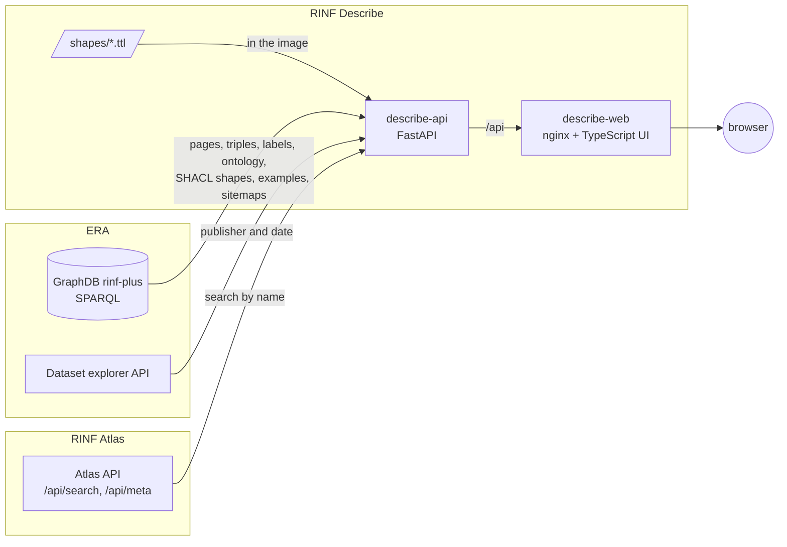

# Architecture

RINF Describe has no indexer and no database. The API builds every page on the spot
from ERA's SPARQL endpoint with this repository's SHACL shapes, and asks
[RINF Atlas](https://github.com/Matdata-eu/rinf-atlas)'s public API for one thing only:
names for the search box. RINF Describe is two containers.

| Part | Technology | Role |
|---|---|---|
| `shapes/` | SHACL, DASH, `rd:` terms | What each class page shows: groups, tabs, order, and the widget of each row ([shapes.md](shapes.md)). Compiled by the API at start. |
| `describe-api` | Python, FastAPI, httpx, pyoxigraph | Pages, triples, graph, data model, exports, examples and sitemaps from ERA's SPARQL endpoint; publisher and publication date from ERA's dataset explorer; search through Atlas. Contract: `/api/docs` on a running instance. |
| `describe-web` | TypeScript, Vite, MapLibre GL JS, vis-network, nginx | The single-page UI; nginx serves the build, proxies `/api/` to the API and writes the search engine settings at start ([seo.md](seo.md)). |

## A page, end to end

1. The browser opens `/describe?uri=<IRI>&env=prod`. nginx answers with the app.
2. The app calls `GET /api/describe`. The API (`api/app/livepage.py`) asks ERA's endpoint
   in three rounds, each run in parallel: the resource's named graph, classes and triple
   counts; the rows of the matching shapes, evaluated inside that graph, a few rows per
   query; and the labels of every IRI on the page. A few hundred milliseconds at most.
   The page is kept for ten minutes, or longer when its shape says so (`rd:cacheSeconds`:
   national line and infrastructure manager pages, which sum up thousands of resources,
   are kept a day). The shapes that apply are those of the resource's
   classes and their superclasses in the ERA ontology, merged into one page (the base
   page of `era:InfrastructureElement` under the class page).
3. The response carries what the ERA ontology says about the properties on the page
   (`api/app/ontology.py`, read once a day from the endpoint's ontology graph): label,
   definition, unit and RINF index, and the names of the RINF index chapters. They give
   every row its help text and unit, and the RINF parameters tab its chapters.
4. The app lays the page out from the layout alone (`web/src/layout.ts`): groups become
   cards, `rd:tab` groups become tabs, `dash:KeyInfoRole` rows become badges, and each
   row's `dash:viewer` picks a widget from `web/src/widgets/`. No class name appears in
   the UI code.
5. All properties, Incoming links and Graph load on demand from `/api/triples` and
   `/api/graph`, which read the triples from the endpoint too. Data model loads from
   `/api/model`: the resource's class, its superclasses and their associations from ERA's
   SHACL shapes graph (`graph/rinf/shacl`, read with the ontology once a day), and which of
   those properties the resource uses. Its "What this page shows" view walks every row path
   of the page's shape (`rd:over`, `sh:path`, columns, `rd:` paths) over the same model, hop by
   hop, and draws the classes and properties the page reads; a step ERA's shapes do not
   define is marked.

The start page's examples (one resource per class with a shape of its own) and the
sitemaps (every resource of a class with a page, subclasses included) are SPARQL queries
as well, kept for a day. The search box sends names to Atlas's `/api/search`, limited
to the classes with a page; a pasted IRI opens directly.

## Key design choices

- **Live, nothing stored.** A page is a handful of batched SPARQL queries, fast enough
  that an index ahead of time is not worth keeping up to date. Every page shows what ERA
  publishes today, for every resource, in every environment.
- **Layout is data.** The shapes are the only place a class page is defined. The API
  compiles them to plain JSON rows and passes them through; the UI only knows viewers.
  Adding a class is a Turtle file.
- **Atlas for names only.** Searching labels across ERA's data needs a full-text index;
  Atlas already keeps one, so the search box asks its public API. Without
  `DESCRIBE_ATLAS_URL` the search box takes IRIs only, and everything else works.
- **Same stack and design as Atlas.** FastAPI, Vite and nginx, IBM Plex, the rail navy and
  signal amber of Atlas, light and dark themes, MapLibre with OpenStreetMap and
  OpenRailwayMap, vis-network for graphs. Images are published the same way
  (`.github/workflows/docker-publish.yml`).
- **One address per resource.** Unlike Atlas's single map view, every resource has its own
  URL. With a public address set, each page gets its own title, description and canonical
  link, and the API lists every resource of a class with a shape in the default
  environment in the sitemaps ([seo.md](seo.md)).
- **Nothing about the visitor is stored.** No cookies or analytics; the theme and whether
  the tour and latest changes were seen stay in the browser ([privacy.md](privacy.md)).

## Repository layout

| Path | What |
|---|---|
| `shapes/` | Describe shapes |
| `api/app/main.py` | HTTP API |
| `api/app/live.py` | ERA's SPARQL endpoint (triples, labels) and dataset explorer |
| `api/app/atlas.py` | RINF Atlas's search API |
| `api/app/shapes.py`, `livepage.py` | The shapes compiled and merged, and class pages evaluated from them |
| `api/app/ontology.py` | The ERA ontology and SHACL shapes: property help, units, RINF index, class hierarchy, each class's properties |
| `api/app/datamodel.py` | The Data model tab: a class in ERA's model, and the classes and properties a page's rows pass through |
| `api/app/rdf.py` | Turtle, N-Triples and CSV writers |
| `web/src/page.ts`, `layout.ts` | The describe page and its layout from the compiled shapes |
| `web/src/widgets/` | One module per viewer |
| `web/src/help.ts`, `tour.ts`, `about.ts`, `whats-new.ts` | Help, first-visit tour, About and release notes |
| `web/src/seo.ts`, `web/docker-entrypoint.d/` | Search engine tags per page and per instance |
| `site/` | Deployer pages such as the privacy statement |
| `scripts/bench_live.py` | Times pages against ERA's endpoint |
| `tests/` | The shapes on the Luxembourg sample, served as a SPARQL endpoint by pyoxigraph |
