# Widgets

A widget draws one row of a class page. A row picks its widget with `dash:viewer`; without
one it gets the plain viewer that fits its data (a label, a literal with its unit, a table).
The widgets below are ours, in the `rd:` namespace (`https://rinf-describe.matdata.eu/ns#`),
declared in [`shapes/describe.ttl`](../shapes/describe.ttl). Each is a `dash:SingleViewer` or
`dash:MultiViewer`, so another DASH tool reading the shapes knows what kind of viewer it is
and can fall back to a plain one.

How shapes, rows, groups and tabs work, and every `rd:` term: [shapes.md](shapes.md). This
page is the widget catalogue: what each one is for, how to set it up, and what it looks like
on production data. The snippets are taken from the shapes in [`shapes/`](../shapes); the
screenshots are of PROD on 30 October 2026, light theme.

## How a widget gets its data

A widget reads one or more of these, as its section says:

- **`sh:path`**: the values of the row, like any SHACL property shape.
- **`sh:node`**: the columns of each linked resource (a table row per resource). The
  widget reads the columns by their `rd:key` (`start`, `end`, `wkt`...).
- **Named paths** (`rd:start`, `rd:km`, `rd:height`...): a predicate `rd:x` whose object is
  a path. The API evaluates each one and hands it to the widget as parameter `x`. These
  rows often have no `sh:path` at all.
- **Settings** (`rd:symbol "country"`, `rd:marks "..."`): an `rd:x` with a literal.
- **Other rows** (`rd:table "section-table"`, `rd:markers "..."`, `rd:figures "..."`): the
  key of other rows on the same page whose values the widget draws. Those rows are often
  `rd:hidden "true"`: read for the widget, not shown themselves.

A row whose widget finds nothing to draw is hidden, like any empty row.

## Contents

| Widget | Shows | Used on |
|---|---|---|
| [`rd:MapViewer`](#map) | Geometry on OpenStreetMap + OpenRailwayMap | Every infrastructure page |
| [`rd:RouteDiagramViewer`](#route-diagram) | A section of line from end to end | Section of line |
| [`rd:AlongLineViewer`](#along-the-line) | Assets along a section at their km | Section of line |
| [`rd:LrsLocationViewer`](#railway-location) | A value with its km position | Section of line, infrastructure element |
| [`rd:AggregateViewer`](#summary-over-linked-resources) | A value summed up over linked resources | Section of line, operational point, ... |
| [`rd:ConnectionsViewer`](#connections) | Sections of line around an operational point | Operational point |
| [`rd:TrackLayoutViewer`](#track-layout) | Tracks, platforms and sidings of a station | Operational point |
| [`rd:PlatformViewer`](#platform) | Platform edge against the TSI heights | Platform edge |
| [`rd:CrossSectionViewer`](#cross-section) | A track end-on | Running track |
| [`rd:StepChartViewer`](#step-chart) | A gradient profile | Running track |
| [`rd:SymbolViewer`](#symbol) | A symbol per value | Running track, platform edge, every infrastructure page |
| [`rd:ScaleBarViewer`](#scale-bar) | A length or range against reference marks | Siding, platform edge, contact line system |
| [`rd:ValidityViewer`](#validity) | Validity period on a time axis | Every infrastructure page |
| [`rd:ChangesViewer`](#changes-over-time) | Parameters that change at a date | Primary location |
| [`rd:FacilitiesViewer`](#facilities) | Yes/no parameters as tiles | Siding, tunnel, primary location |
| [`rd:DocumentViewer`](#document) | Linked documents as cards | Tunnel, operational point, ... |
| [`rd:LineProfileViewer`](#line-profile) | A national line along its km, lane per parameter | National line |
| [`rd:LineStopsViewer`](#operational-points-along-a-line) | Operational points of a line in km order | National line |
| [`rd:LinePositionViewer`](#position-on-the-line) | A kilometric post on its line | Kilometric post |
| [`rd:KeyFiguresViewer`](#key-figures) | Stat tiles and share bars | Infrastructure manager |
| [`rd:ConceptTreeViewer`](#concept-tree) | SKOS concepts as a tree | Concept scheme, concept |
| [`rd:TopologyViewer`](#topology) | Net relations around a linear element | Linear element |
| [`rd:PositionedViewer`](#positioned-on-an-element) | What lies on a linear element | Linear element |
| [`rd:ParameterIndexViewer`](#rinf-parameters) | Every RINF parameter by index chapter | Every infrastructure page |
| [`rd:DataStatusViewer`, `rd:GraphViewer`](#on-every-page) | Data status card, neighbourhood graph | Every page, no shape needed |

---

## Map

`rd:MapViewer` draws WKT geometries on OpenStreetMap with the OpenRailwayMap overlay, the
WKT text folded below. The values of `sh:path` are highlighted; `rd:context` (a path) adds
geometries drawn quieter (the section of line of a track). `rd:layers` names table rows of
the page whose `wkt` column becomes a layer that can be switched off, each line or point
opening its page. A map row without a group goes to the top of the Overview tab.

```turtle
sh:property [
    sh:path [ sh:alternativePath ( ( era:netReference gsp:hasGeometry gsp:asWKT ) ( gsp:hasGeometry gsp:asWKT ) ) ] ;
    sh:name "Map" ; rd:key "map" ; sh:order 2 ;
    dash:viewer rd:MapViewer ;
    rd:layers "connections track-table" ;
] ;
```

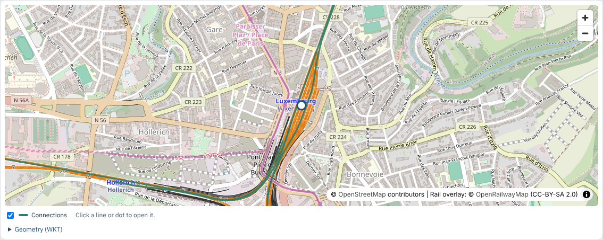

*Operational point Luxembourg (`http://data.europa.eu/949/operationalPoint/1612530560`), from
[operational-point.ttl](../shapes/operational-point.ttl).*

## Route diagram

`rd:RouteDiagramViewer` draws a section of line from its start to its end operational point,
with its length and, when the data has them, the km positions of both ends. It has no
`sh:path`: every value comes from a named path.

| Term | Path to |
|---|---|
| `rd:start`, `rd:end` | The end points (each opens its page) |
| `rd:length` | The length, with `rd:unit` |
| `rd:startKm`, `rd:startOffset`, `rd:endKm`, `rd:endOffset` | Optional: km of the kilometric post and offset in metres, written `km 39+500` |

```turtle
sh:property [
    sh:name "Route diagram" ; rd:key "route" ; sh:order 1 ;
    dash:viewer rd:RouteDiagramViewer ;
    rd:start era:opStart ;
    rd:end era:opEnd ;
    rd:length era:lengthOfSectionOfLine ;
    rd:startKm ( era:netReference era:startsAt era:hasLrsCoordinate era:kmPost era:kilometer ) ;
    rd:startOffset ( era:netReference era:startsAt era:hasLrsCoordinate era:offsetFromKilometricPost ) ;
    rd:endKm ( era:netReference era:endsAt era:hasLrsCoordinate era:kmPost era:kilometer ) ;
    rd:endOffset ( era:netReference era:endsAt era:hasLrsCoordinate era:offsetFromKilometricPost ) ;
    rd:unit "km" ;
] ;
```

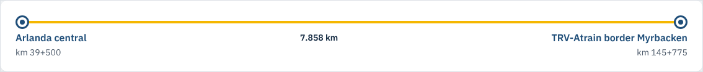

*Section of line Arlanda central – TRV-Atrain border Myrbacken
(`http://data.europa.eu/949/sectionOfLine/eb71184212`), from
[section-of-line.ttl](../shapes/section-of-line.ttl).*

## Along the line

`rd:AlongLineViewer` draws a section of line as a strip between its operational points, with
assets at their km: stretches (tunnels, phase separations) as bands, points (kilometric posts)
as ticks. Hover shows the name and km; a click opens the asset.

- `rd:table` names the route diagram row, which gives the strip its km at both ends.
- `rd:markers` names the rows with the assets, one legend entry each. Those rows are
  `rd:hidden "true"` and their `sh:node` gives `km` and `offset` for a point,
  `start-km`, `start-offset`, `end-km`, `end-offset` for a stretch, or `km` and `length`
  (metres) for a stretch given by its start.

```turtle
sh:property [
    sh:name "Along the line" ; rd:key "along" ;
    sh:group shape:sol-along ; sh:order 10 ;
    dash:viewer rd:AlongLineViewer ;
    rd:table "route" ;
    rd:markers "along-tunnels along-separations along-posts" ;
] ;
sh:property [
    sh:path ( shape:parts [ sh:inversePath era:isPartOf ] ) ; rd:class era:Tunnel ;
    sh:name "Tunnels" ; rd:key "along-tunnels" ; rd:hidden "true" ;
    sh:node shape:along-stretch ;      # start-km, start-offset, end-km, end-offset
] ;
sh:property [
    sh:path ( era:nationalLine [ sh:inversePath era:hasLRS ] ) ; rd:class era:KilometricPost ;
    sh:name "Kilometric posts" ; rd:key "along-posts" ; rd:hidden "true" ;
    sh:node shape:along-post ;         # km
] ;
```

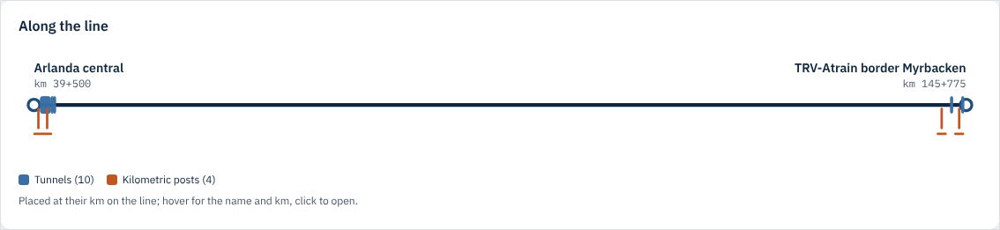

*Section of line Arlanda central – TRV-Atrain border Myrbacken, from
[section-of-line.ttl](../shapes/section-of-line.ttl); the node shapes are in
[common.ttl](../shapes/common.ttl).*

## Railway location

`rd:LrsLocationViewer` writes the value of `sh:path` with its position on the line,
`km 53+240`. `rd:km` is the path to the kilometre of the kilometric post, `rd:offset` the path
to the offset from it in metres.

```turtle
sh:property [
    sh:path era:opStart ; sh:name "From" ;
    sh:group shape:sol-route ; sh:order 10 ;
    dash:viewer rd:LrsLocationViewer ;
    rd:km ( era:netReference era:startsAt era:hasLrsCoordinate era:kmPost era:kilometer ) ;
    rd:offset ( era:netReference era:startsAt era:hasLrsCoordinate era:offsetFromKilometricPost ) ;
] ;
```

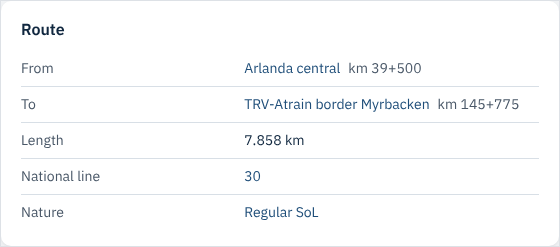

*The Route card of section of line Arlanda central – TRV-Atrain border Myrbacken: From and To
use this widget.*

## Summary over linked resources

`rd:AggregateViewer` evaluates `sh:path` on every resource reached by `rd:over` and sums the
values up as `rd:aggregate` says:

| `rd:aggregate` | Shows |
|---|---|
| `"range"` | `85–140 km/h`, or one value when all are equal |
| `"distinct-count"` | Each value with how many resources have it: `1435 (2) · 1668 (1)` |
| `"count"` | How many resources were reached |
| `"sum"` | The sum of the first value of each |

`rd:class` keeps only the linked resources of a class (the tracks among the parts). With
`dash:propertyRole dash:KeyInfoRole` the result is also a badge under the title, worded by
`rd:badge` (`"{count} tracks"`, `"Electrified {withValue} of {children}"`). With a distinct
count, `rd:weight` (a path) makes the shares by that number rather than by count.

```turtle
sh:property [
    sh:path era:maximumPermittedSpeed ; sh:name "Maximum permitted speed" ;
    rd:over [ sh:alternativePath ( era:hasPart [ sh:inversePath era:isPartOf ] ) ] ;
    rd:aggregate "range" ; rd:unit "km/h" ;
    sh:group shape:sol-tracks ; sh:order 20 ;
    dash:viewer rd:AggregateViewer ;
    dash:propertyRole dash:KeyInfoRole ;
] ;
sh:property [
    sh:path ( era:contactLineSystem era:contactLineSystemType ) ; sh:name "Contact line system" ;
    rd:over [ sh:alternativePath ( era:hasPart [ sh:inversePath era:isPartOf ] ) ] ;
    rd:aggregate "distinct-count" ;
    sh:group shape:sol-tracks ; sh:order 40 ;
    dash:viewer rd:AggregateViewer ;
    dash:propertyRole dash:KeyInfoRole ; rd:badge "Electrified {withValue} of {children}" ;
] ;
```

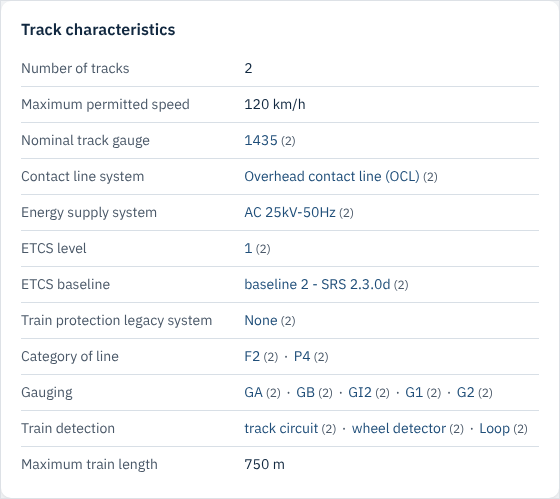

*The Track characteristics card of section of line Luxembourg – Cents-Hamm
(`http://data.europa.eu/949/sectionOfLine/4eac6a5783`): every row is an aggregate over its
two tracks.*

## Connections

`rd:ConnectionsViewer` draws the sections of line that start or end at an operational point
as spokes, each pointing the way its section goes (to its far end, north up) and ending at
the operational point at its other end, with line and length. A spoke opens its section; a
table below lists the sections. Not to scale.

`sh:path` reaches the sections; `sh:node` gives the columns `start`, `end`, `line`, `length`
and `wkt`. `rd:scope "all"` also finds the sections another infrastructure manager publishes
(across a border).

```turtle
sh:property [
    sh:path [ sh:alternativePath ( [ sh:inversePath era:opStart ] [ sh:inversePath era:opEnd ] ) ] ;
    sh:name "Connections" ; rd:key "connections" ;
    sh:group shape:op-connections ; sh:order 10 ;
    rd:class era:SectionOfLine ; rd:scope "all" ;
    dash:viewer rd:ConnectionsViewer ;
    sh:node shape:op-connection ;
] ;

shape:op-connection
    a sh:NodeShape ;
    sh:property [ sh:path era:opStart ; sh:name "From" ; rd:key "start" ; sh:order 10 ] ;
    sh:property [ sh:path era:opEnd ; sh:name "To" ; rd:key "end" ; sh:order 20 ] ;
    sh:property [ sh:path era:nationalLine ; sh:name "Line" ; rd:key "line" ; sh:order 30 ] ;
    sh:property [ sh:path era:lengthOfSectionOfLine ; sh:name "Length" ; rd:key "length" ; sh:order 40 ] ;
    sh:property [ sh:path ( era:netReference gsp:hasGeometry gsp:asWKT ) ; sh:name "Geometry" ; rd:key "wkt" ; sh:order 90 ] .
```

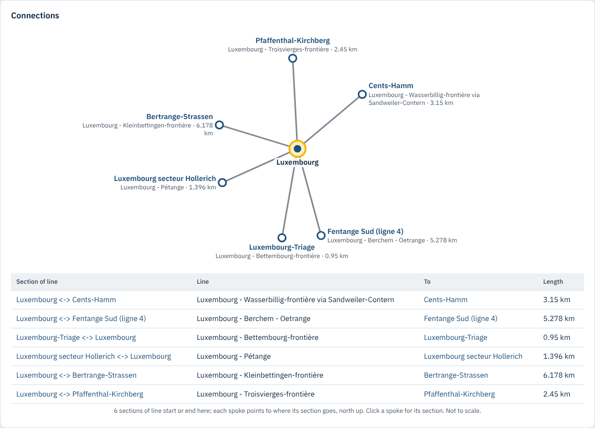

*Operational point Luxembourg.*

## Track layout

`rd:TrackLayoutViewer` draws an operational point's tracks as parallel bars, its platform
edges on the tracks they serve and its sidings below. Platforms and sidings are drawn to their
usable length relative to the longest; tracks are not to scale.

`sh:path` reaches the tracks (`sh:node` with column `id`). `rd:platforms` and `rd:sidings`
name the table rows of the page with the platform edges (columns `track`, `length`,
`height`) and the sidings (`length`).

```turtle
sh:property [
    sh:path shape:parts ; sh:name "Track layout" ; rd:key "layout" ;
    sh:group shape:op-layout ; sh:order 10 ;
    rd:class era:RunningTrack ;
    dash:viewer rd:TrackLayoutViewer ;
    rd:platforms "platform-table" ; rd:sidings "siding-table" ;
    sh:node shape:op-layout-track ;
] ;
```

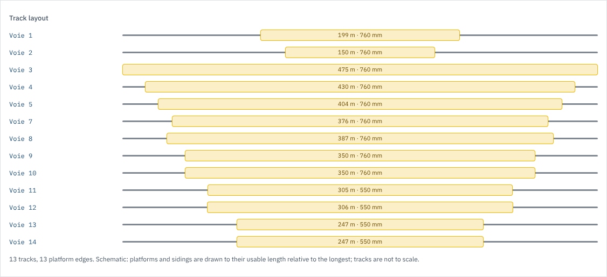

*Operational point Luxembourg.*

## Platform

`rd:PlatformViewer` draws a platform edge from the side, its height to scale against the TSI
platform heights of 550 and 760 mm, with its usable length and whether it is curved. No
`sh:path`; the row goes to the top of the Overview tab.

```turtle
sh:property [
    sh:name "Platform" ; rd:key "sketch" ; sh:order 1 ;
    dash:viewer rd:PlatformViewer ;
    rd:height era:platformHeight ;
    rd:length era:lengthOfPlatform ;
    rd:curved era:hasPlatformCurvature ;
] ;
```

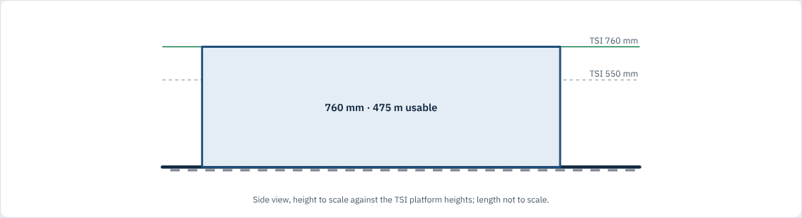

*Platform edge I v3 at Luxembourg (`http://data.europa.eu/949/platform/fd6984d735`), from
[platform-edge.ttl](../shapes/platform-edge.ttl).*

## Cross-section

`rd:CrossSectionViewer` draws a track end-on, not to scale: the nominal gauge, the gauging
profile, the contact wire height range and the rail inclination. Each is a named path; parts
without data are left out.

```turtle
sh:property [
    sh:name "Cross-section" ; rd:key "cross-section" ;
    sh:group shape:rt-rcc-infrastructure ; sh:order 1 ;
    dash:viewer rd:CrossSectionViewer ;
    rd:gauge era:wheelSetGauge ;
    rd:loadingGauge era:gaugingProfile ;
    rd:wireMin ( era:contactLineSystem era:minimumContactWireHeight ) ;
    rd:wireMax ( era:contactLineSystem era:maximumContactWireHeight ) ;
    rd:inclination era:railInclination ;
] ;
```


*Running track U1 (`http://data.europa.eu/949/track/a765d183cd`), from
[running-track.ttl](../shapes/running-track.ttl).*

## Step chart

`rd:StepChartViewer` draws a profile written as `value(length),value(length),...` (ERA's
gradient profile) as a step chart along the track: rising steps green, falling red, with the
steepest rise and fall below and the value as published folded away. `rd:unit` is the unit of
the values, `rd:lengthUnit` that of the lengths.

```turtle
sh:property [
    sh:path era:gradientProfile ; sh:name "Gradient profile" ;
    sh:group shape:rt-gradient ; sh:order 10 ;
    dash:viewer rd:StepChartViewer ; rd:unit "‰" ; rd:lengthUnit "m" ;
] ;
```

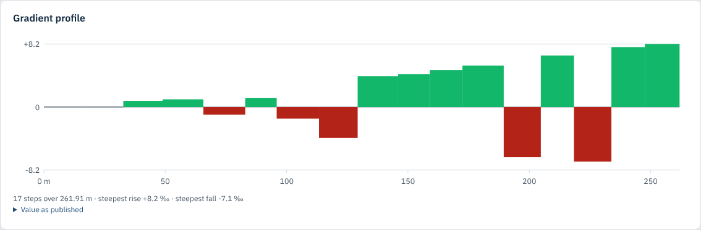

*Running track V307-V102 (`http://data.europa.eu/949/track/003624ce0d`).*

## Symbol

`rd:SymbolViewer` puts an illustrative, non-dimensioned symbol next to each value's label.
`rd:symbol` picks the set:

| `rd:symbol` | For |
|---|---|
| `"track-gauge"` | Nominal track gauge |
| `"loading-gauge"` | Gauging profile |
| `"country"` | Country (its flag) |
| `"platform-height"` | Platform height |
| `"direction"` | Normal running direction, signal orientation |
| `"energy-supply"` | Energy supply system (AC/DC) |

```turtle
sh:property [
    sh:path era:wheelSetGauge ; sh:name "Nominal track gauge" ;
    sh:group shape:rt-characteristics ; sh:order 20 ;
    dash:viewer rd:SymbolViewer ; rd:symbol "track-gauge" ;
] ;
sh:property [
    sh:path era:gaugingProfile ; sh:name "Gauging" ;
    sh:group shape:rt-characteristics ; sh:order 30 ;
    dash:viewer rd:SymbolViewer ; rd:symbol "loading-gauge" ;
] ;
```

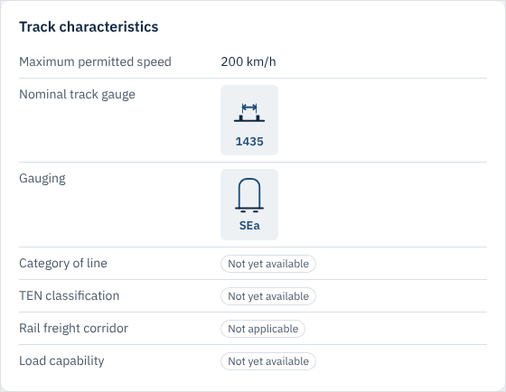

*The Track characteristics card of running track U1.*

## Scale bar

`rd:ScaleBarViewer` draws a length as a bar against reference marks, or a range on a scale.

- One value: `sh:path` and `rd:marks`, value–label pairs separated by semicolons
  (`"400 Passenger train; 740 Freight train"`).
- A range: `rd:min` and `rd:max` (paths) and `rd:scale "4 7"`, the ends of the scale.

```turtle
sh:property [
    sh:path era:lengthOfSiding ; sh:name "Usable length" ;
    sh:group shape:siding-characteristics ; sh:order 20 ;
    dash:viewer rd:ScaleBarViewer ; rd:marks "400 Passenger train; 740 Freight train" ;
] ;
```

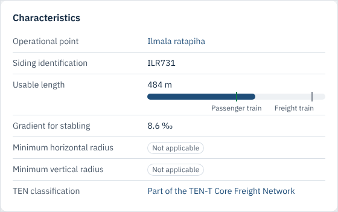

*Siding ILR731 (`http://data.europa.eu/949/siding/d517c232a4`), from
[siding.ttl](../shapes/siding.ttl). The contact wire height of a contact line system is the
range form ([contact-line-system.ttl](../shapes/contact-line-system.ttl)).*

## Validity

`rd:ValidityViewer` draws the validity period as a bar on a time axis with today marked, and
says whether the resource is valid today. `rd:begin` and `rd:end` are paths to `xsd:date`s;
`era:validity` is an `era:TemporalFeature`, a `time:TemporalDuration`, and the named paths
`shape:validity-begin` and `shape:validity-end` in [common.ttl](../shapes/common.ttl) reach
its ends.

```turtle
sh:property [
    sh:name "Validity" ; rd:key "validity" ;
    sh:group shape:ie-identification ; sh:order 60 ;
    dash:viewer rd:ValidityViewer ;
    rd:begin shape:validity-begin ;
    rd:end shape:validity-end ;
] ;
```


*Operational point Luxembourg; the row comes from
[infrastructure-element.ttl](../shapes/infrastructure-element.ttl).*

## Changes over time

`rd:ChangesViewer` draws parameters that apply from or until a date
(`era:parameterApplicability`) on a time axis with today marked, one line per parameter with
its value. `sh:node` gives the columns `parameter`, `value`, `begin` and `end`.

```turtle
sh:property [
    sh:path era:parameterApplicability ; sh:name "Changes over time" ; rd:key "changes" ;
    sh:group shape:pl-use ; sh:order 20 ;
    dash:viewer rd:ChangesViewer ;
    sh:node shape:pl-change ;
] ;

shape:pl-change
    a sh:NodeShape ;
    sh:property [ sh:path era:ofParameter ; rd:key "parameter" ] ;
    sh:property [ sh:path era:parameterValue ; rd:key "value" ] ;
    sh:property [ sh:path ( time:hasBeginning [ sh:alternativePath ( time:inXSDDate time:inXSDDateTimeStamp ) ] ) ; rd:key "begin" ] ;
    sh:property [ sh:path ( time:hasEnd [ sh:alternativePath ( time:inXSDDate time:inXSDDateTimeStamp ) ] ) ; rd:key "end" ] .
```

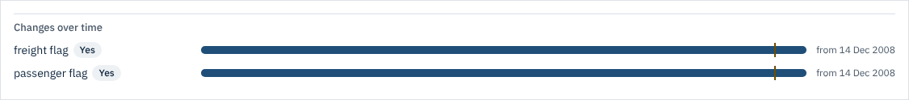

*Primary location DE13862 (`http://data.europa.eu/949/primaryLocation/DE13862`), from
[primary-location.ttl](../shapes/primary-location.ttl). Only German primary locations carry
`era:parameterApplicability` today.*

## Facilities

`rd:FacilitiesViewer` shows yes/no parameters as tiles: yes, no, not applicable or not yet
available (from the resource's `era:notApplicable` and `era:notYetAvailable`). Give
`rd:facility` once per property; there is no `sh:path`.

```turtle
sh:property [
    sh:name "Servicing" ; rd:key "servicing" ;
    sh:group shape:siding-servicing ; sh:order 10 ;
    dash:viewer rd:FacilitiesViewer ;
    rd:facility era:hasToiletDischarge, era:hasExternalCleaning, era:hasWaterRestocking,
                era:hasRefuelling, era:hasSandRestocking, era:hasElectricShoreSupply ;
] ;
```

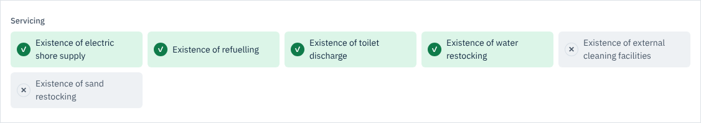

*Siding ILR731.*

## Document

`rd:DocumentViewer` shows `era:Document` resources as cards: file type, name, address and an
Open button. `sh:node shape:document-card` (in [common.ttl](../shapes/common.ttl)) gives the
columns `url` and `name`.

```turtle
sh:property [
    sh:path era:tunnelDocRef ; sh:name "Description of the tunnel" ;
    sh:group shape:tunnel-documents ; sh:order 10 ;
    dash:viewer rd:DocumentViewer ; sh:node shape:document-card ;
] ;
```

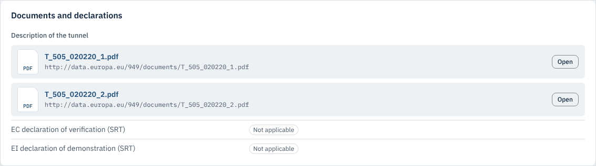

*The Documents and declarations card of tunnel CZ00505
(`http://data.europa.eu/949/functionalInfrastructure/tunnels/15e02188b0c2bc885d253a381a5f5ce4006de85f`),
from [tunnel.ttl](../shapes/tunnel.ttl).*

## Line profile

`rd:LineProfileViewer` draws a national line along its km: one lane per column of its
sections. Numbers are drawn as steps with the section's highest value, categories as coloured
bands with their most common value, gradient profiles as the steepest gradient along the km;
operational points are ticks along the top. No `sh:path`.

- `rd:table`: the row with the sections of the line, whose `sh:node` has `start-km`,
  `start-offset`, `end-km`, `end-offset`, `length`, `from`, `to` and the lane columns.
  Lane columns sum up over each section's tracks with `rd:over` on the column.
- `rd:lanes`: the columns drawn as lanes, in order.
- `rd:profiles`: the lanes holding `era:gradientProfile` values.

```turtle
sh:property [
    sh:name "Line profile" ; rd:key "profile" ; sh:order 3 ;
    dash:viewer rd:LineProfileViewer ;
    rd:table "section-table" ;
    rd:lanes "speed energy etcs legacy gauging axle-load gradient gauge tracks" ;
    rd:profiles "gradient" ;
] ;
```

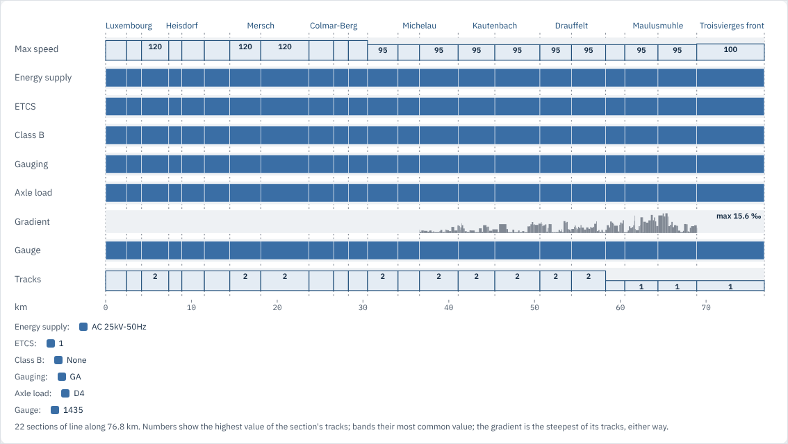

*National line Luxembourg – Troisvierges-frontière
(`http://data.europa.eu/949/lrs/3d5c54deb2`), from
[national-line.ttl](../shapes/national-line.ttl), where `shape:nl-section-row` has the
columns.*

## Operational points along a line

`rd:LineStopsViewer` lists the operational points of a line in km order with their type,
taken from the ends of the sections in `rd:table` (as for the line profile, plus columns
`from-type` and `to-type`).

```turtle
sh:property [
    sh:name "Operational points" ; rd:key "stops" ;
    sh:group shape:nl-stops ; sh:order 10 ;
    dash:viewer rd:LineStopsViewer ;
    rd:table "section-table" ;
] ;
```

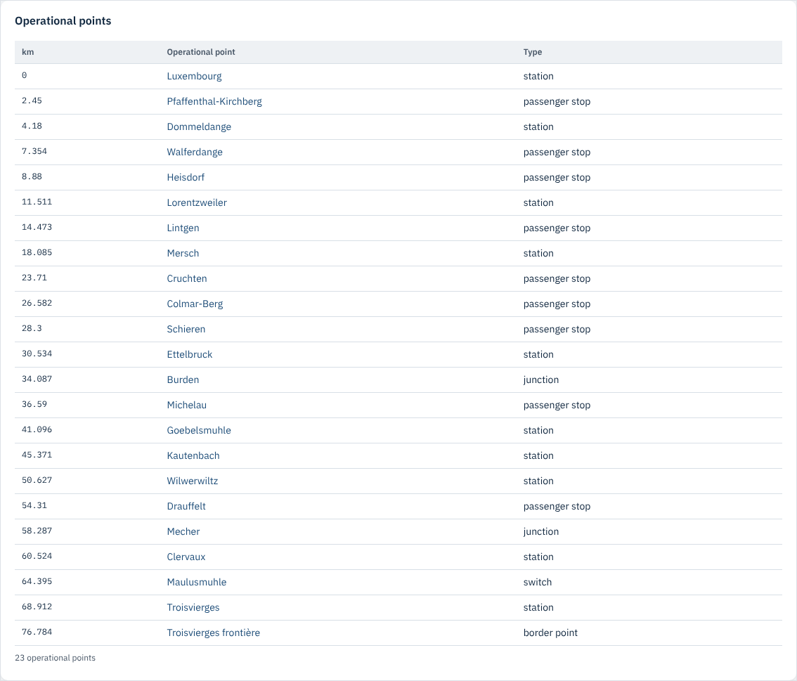

*National line Luxembourg – Troisvierges-frontière.*

## Position on the line

`rd:LinePositionViewer` places a kilometric post on its line: the line from its first to its
last km with its operational points and posts, and the operational point and post either side
of this one. It reads the page's `km` row; `rd:table` names the row with the line's sections
(`from`, `to`, `start-km`…`end-offset`) and `rd:posts` the row with its posts (column `km`),
both hidden.

```turtle
sh:property [
    sh:name "Position on the line" ; rd:key "position" ;
    sh:group shape:kp-line ; sh:order 10 ;
    dash:viewer rd:LinePositionViewer ;
    rd:table "line-sections" ;
    rd:posts "line-posts" ;
] ;
```

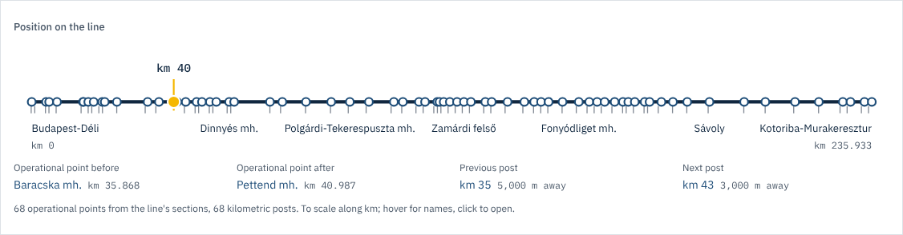

*Kilometric post `http://data.europa.eu/949/kilometricPost/10c0e614c9`, from
[kilometric-post.ttl](../shapes/kilometric-post.ttl). Posts without `era:kilometer` (as in
Luxembourg today) cannot be placed, and the row is hidden.*

## Key figures

`rd:KeyFiguresViewer` shows other rows of the page as stat tiles: a number for a count, sum
or range, and a share bar for a distinct count (by `rd:weight` when the row has one, so
shares are in track-km). `rd:figures` names the rows, which are usually hidden aggregates. The
row itself needs no path.

```turtle
sh:property [
    sh:name "Key figures" ; rd:key "figures" ;
    sh:group shape:im-figures ; sh:order 10 ;
    dash:viewer rd:KeyFiguresViewer ;
    rd:figures "im-ops im-sections im-km im-tracks im-energy im-etcs im-gauge im-gauging" ;
] ;
sh:property [
    sh:path ( era:contactLineSystem era:energySupplySystem ) ; sh:name "Energy supply of the line tracks" ;
    rd:key "im-energy" ; rd:hidden "true" ;
    rd:over shape:line-tracks ; rd:class era:RunningTrack ; rd:aggregate "distinct-count" ; rd:scope "all" ;
    rd:weight shape:track-km ; rd:weightUnit "track-km" ;
] ;
```

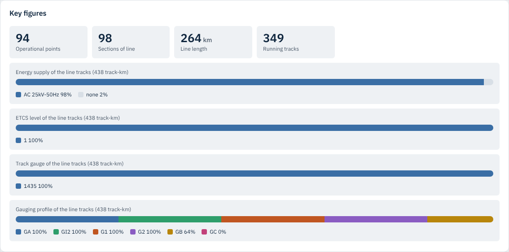

*Infrastructure manager 0082, CFL
(`http://data.europa.eu/949/body/organisation/organisationRole/0082_IM`), from
[infrastructure-manager.ttl](../shapes/infrastructure-manager.ttl).*

## Concept tree

`rd:ConceptTreeViewer` shows SKOS concepts as a tree along `skos:broader`, with their
notation, and a filter on larger trees. On a concept page the concept is marked and the branch
down to it open. `sh:node` gives the columns `broader` and `notation`.

```turtle
sh:property [
    sh:path shape:scheme-concepts ;
    sh:name "Tree" ; rd:key "tree" ;
    sh:group shape:cs-tree ; sh:order 10 ;
    dash:viewer rd:ConceptTreeViewer ;
    sh:node shape:concept-tree-row ;
] ;

shape:concept-tree-row
    a sh:NodeShape ;
    sh:property [ sh:path [ sh:alternativePath ( skos:broader [ sh:inversePath skos:narrower ] ) ] ; rd:key "broader" ; sh:order 10 ] ;
    sh:property [ sh:path skos:notation ; rd:key "notation" ; sh:order 20 ] .
```

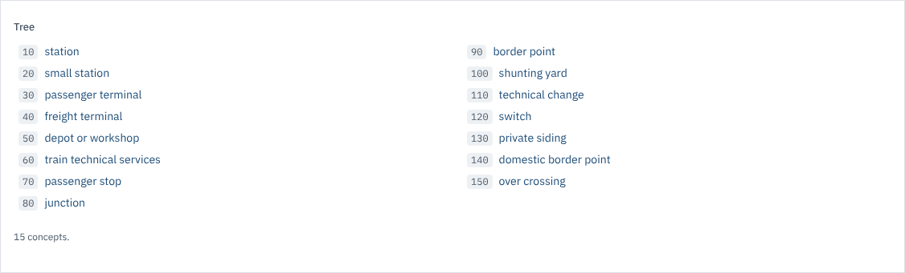

*Concept scheme Operational Point Types
(`http://data.europa.eu/949/concepts/op-types/OperationalPointTypes`), from
[concept-scheme.ttl](../shapes/concept-scheme.ttl); the concept page uses it in
[concept.ttl](../shapes/concept.ttl).*

## Topology

`rd:TopologyViewer` draws the net relations around a linear element as a graph: elements as
nodes, placed as they lie on the map, relations as edges with arrows the way a train can pass,
dashed when it cannot. Zoom, drag, Fit and Full screen; a node opens its element.

`sh:path` reaches the relations; `sh:node` gives the columns `a`, `b`, `navigability`,
`origin-a` and `origin-b`. `rd:elements` names the row with the elements (columns `wkt` and
`length`), which places the nodes.

```turtle
sh:property [
    sh:path [ sh:alternativePath ( shape:le-relations ( shape:le-neighbours shape:le-relations ) ) ] ;
    sh:name "Two relations out" ; rd:key "topology" ;
    sh:group shape:le-topology ; sh:order 10 ;
    dash:viewer rd:TopologyViewer ;
    rd:elements "network" ;
    sh:node shape:le-relation-row ;
] ;
sh:property [
    sh:path [ sh:alternativePath ( shape:le-neighbours ( shape:le-neighbours shape:le-neighbours ) ) ] ;
    sh:name "Elements nearby" ; rd:key "network" ; rd:hidden "true" ;
    sh:group shape:le-topology ; sh:order 20 ;
    sh:node shape:le-row ;
] ;
```

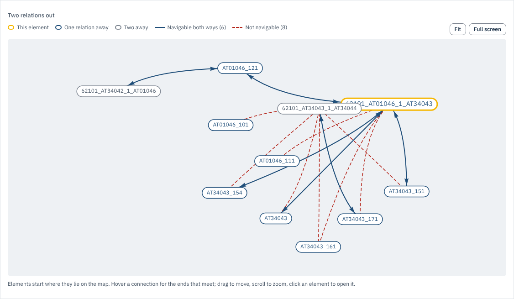

*Linear element 62101_AT01046_1_AT34043
(`http://data.europa.eu/949/topology/netElements/AT/3035/62101_AT01046_1_AT34043`), from
[linear-element.ttl](../shapes/linear-element.ttl).*

## Positioned on an element

`rd:PositionedViewer` shows what is positioned on a linear element: points as ticks at their
offset from its origin, one lane per type, and everything listed by type (with the stretches
that run over the element too). `sh:node` gives the columns `type`, `on` and `offset`.

```turtle
sh:property [
    sh:path [ sh:alternativePath ( ... ) ] ;   # points and stretches whose net reference is on this element
    sh:name "Along the element" ; rd:key "positioned" ;
    sh:group shape:le-positioned ; sh:order 10 ;
    dash:viewer rd:PositionedViewer ;
    sh:node shape:le-positioned-row ;
] ;

shape:le-positioned-row
    a sh:NodeShape ;
    sh:property [ sh:path rdf:type ; rd:key "type" ; sh:order 10 ] ;
    sh:property [ sh:path ( era:netReference era:hasTopoCoordinate era:onLinearElement ) ; rd:key "on" ; sh:order 20 ] ;
    sh:property [ sh:path ( era:netReference era:hasTopoCoordinate era:offsetFromOrigin ) ; rd:key "offset" ; sh:order 30 ] ;
    sh:property [ sh:path ( era:netReference era:appliesToDirection ) ; rd:key "direction" ; sh:order 40 ] .
```

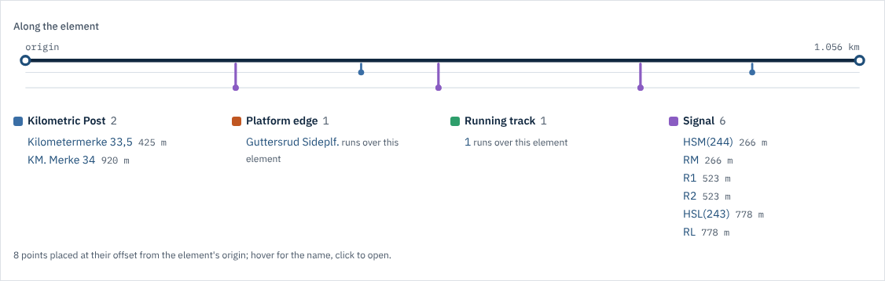

*A linear element of Bane NOR
(`https://data.banenor.no/data/_netelement_003e1cc7-1a4d-43b8-90c4-5027fb9107a9_0.30226429`);
the full path is in [linear-element.ttl](../shapes/linear-element.ttl).*

## RINF parameters

`rd:ParameterIndexViewer` lists every parameter of the resource that has a RINF index in the
ERA ontology, grouped by index chapter, with its unit and definition, and a filter. It also
follows one link to resources that are not infrastructure elements themselves (contact line
system, ETCS...), and shows the parameters marked not applicable or not yet available. No
`sh:path`; `rd:indexRoot "1.2.1"` sets the root (default: the root most parameters share).

```turtle
sh:property [
    sh:name "RINF parameters" ; rd:key "rinf-parameters" ;
    sh:group shape:ie-parameters ; sh:order 10 ;
    dash:viewer rd:ParameterIndexViewer ;
] .
```

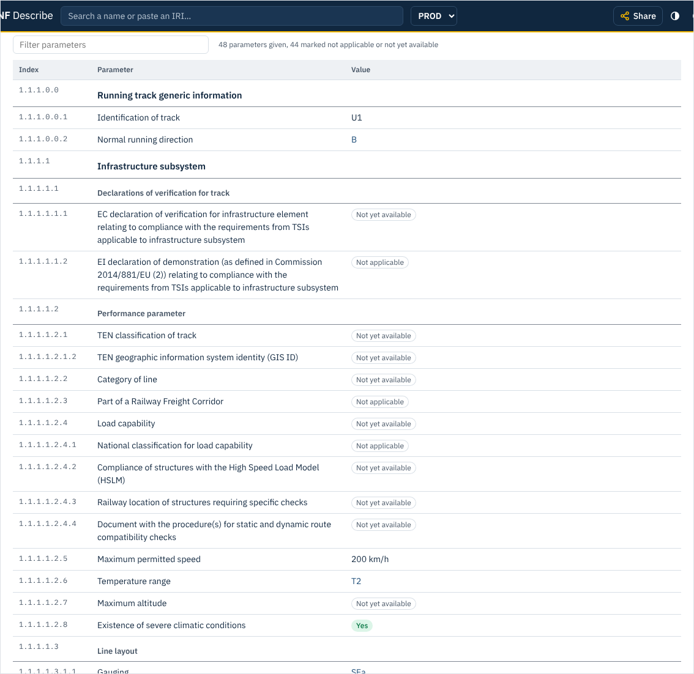

*Running track U1, top of the tab; every infrastructure class gets it from
[infrastructure-element.ttl](../shapes/infrastructure-element.ttl).*

## On every page

Two widgets need no shape. They are declared in `describe.ttl` so they have a name, but the
page adds them itself:

- `rd:DataStatusViewer`: the **Data status** card of every class page, listing the
  parameters the resource marks `era:notApplicable` or `era:notYetAvailable`.
- `rd:GraphViewer`: the **Graph** tab of every resource, its neighbourhood as an interactive
  graph; a node opens its page.

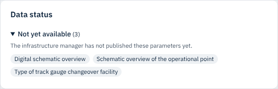

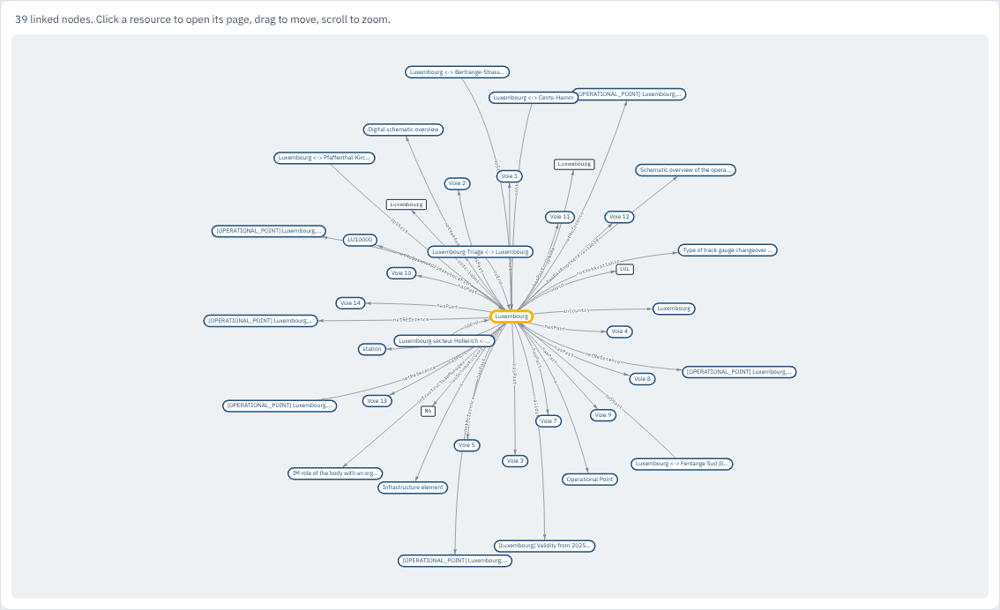

## Adding a widget

1. Declare it in [`shapes/describe.ttl`](../shapes/describe.ttl) as a `dash:SingleViewer`
   (one value) or `dash:MultiViewer` (all values of the row), with a label and a comment that
   names what it reads.
2. Write it in [`web/src/widgets/`](../web/src/widgets) and register it in
   [`index.ts`](../web/src/widgets/index.ts). A widget is a `render(ctx)` that returns a node,
   or `null` to hide the row; `wide: true` makes it take the full width.
3. Use it in a shape, add it here and to the widget table in [shapes.md](shapes.md), and run
   `tests/test_shapes.py`.
